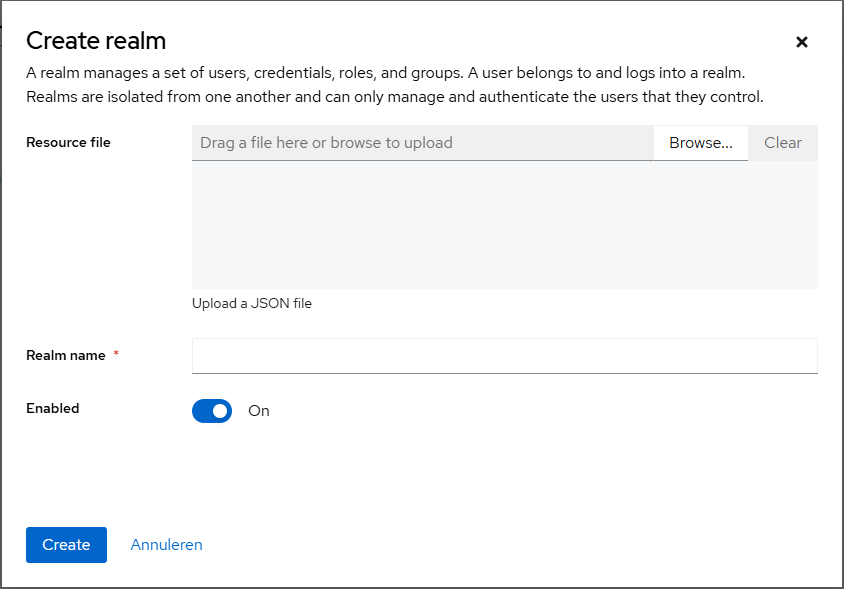
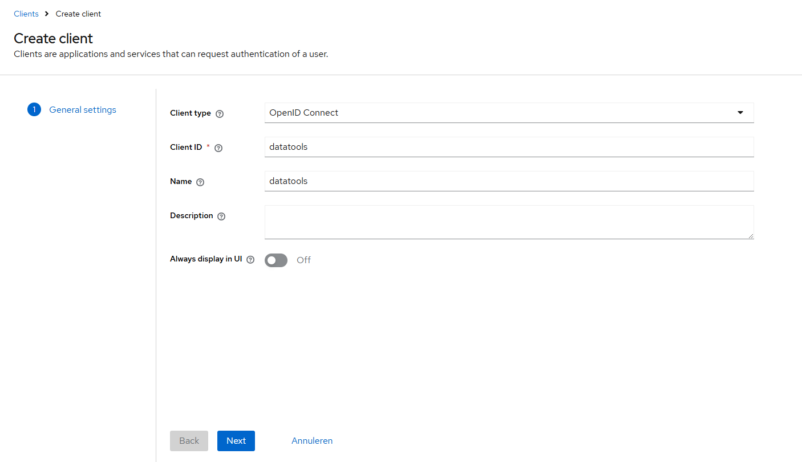
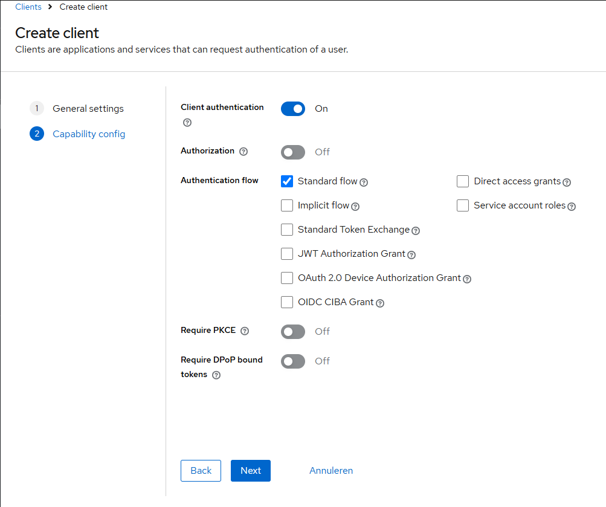
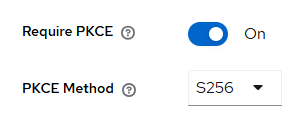
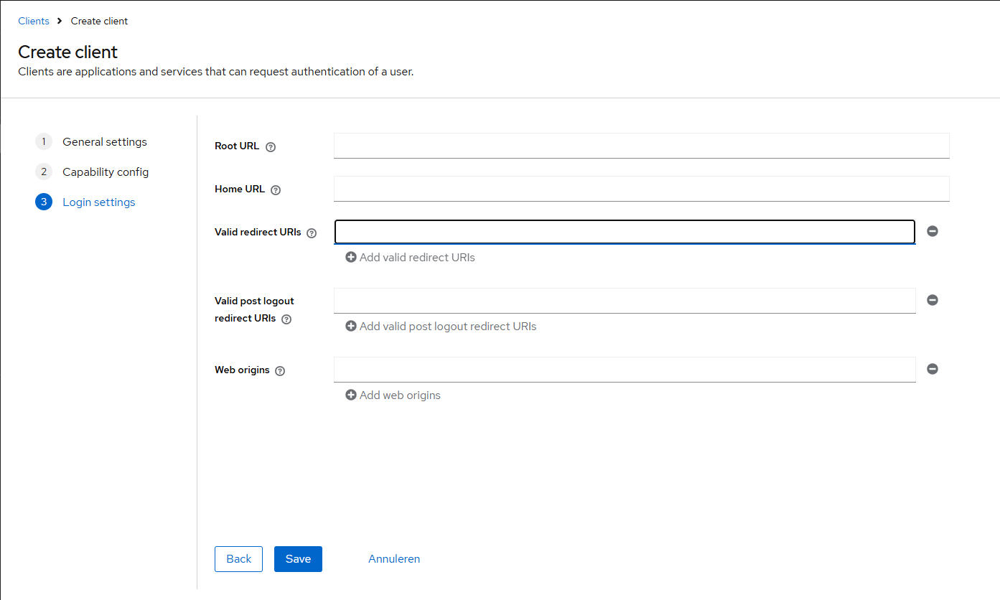

# Use an existing Keycloak realm with Datatools

In this example, Keycloak runs at `https://sso.example.org` and the Datatools UI and API share `https://datatools.example.org`. Replace both addresses with your own. Use Datatools server and UI builds that include OIDC support.

## Choose a realm

Use an existing application realm if it already contains the users who should
sign in to Datatools. Create a realm if you need a separate set of users or
authentication policies. Keycloak reserves the `master` realm for administration.

To create a realm, open the realm selector in the Keycloak Admin Console and
choose **Create realm**. Leave **Resource file** empty, enter a **Realm name**
(for example, `transit`), keep **Enabled** on, and click **Create**.



Select the realm before creating the client. If you created a realm, make sure
the intended first Datatools administrator has an account there before testing
sign-in. Use the selected realm's issuer URL in step 2.

## 1. Create the client in Keycloak

In the Keycloak Admin Console, select your application realm (here, `transit`)
and go to **Clients → Create client**.

### General settings

Choose **OpenID Connect** under **Client type**, set **Client ID** to `datatools`,
and enter an optional display name. Click **Next**.



### Capability config

Turn **Client authentication** on and select **Standard flow**. Leave
**Authorization**, **Direct access grants**, **Implicit flow**, **Service account
roles**, and the other grant types off. Leave **Require DPoP bound tokens** off.



Turn **Require PKCE** on to reveal **PKCE Method**, then select or keep
`S256`. Click **Next**.



On older Keycloak releases without the switch, select `S256` under
**Proof Key for Code Exchange Code Challenge Method** in the client's
**Advanced** settings after saving.

### Login settings

Enter `https://datatools.example.org/api/auth/oidc/callback` under **Valid redirect
URIs**, replacing the example origin with your own. Register the exact URI,
including the scheme, hostname, port if applicable, and path. Leave **Web
origins** empty for this server-side flow. Leave **Valid post logout redirect
URIs** empty because Datatools ends its own session. **Root URL** and **Home
URL** are optional for this configuration. Click **Save**.



After saving, confirm that the client uses `RS256` for ID token signatures,
either inherited from the realm or configured for this client. Leave ID token
encryption unset. Keep the standard `profile` and `email` client scopes available
so Datatools can display the user's name and email. Under **Credentials**, use
**Client ID and Secret** as the client authenticator. Save the generated secret
in your deployment's secret store.

See the [Keycloak Server Administration Guide](https://www.keycloak.org/docs/latest/server_admin/#_oidc_clients) for the client settings.

## 2. Configure Datatools

Use the realm's issuer URL. For this example, open `https://sso.example.org/realms/transit/.well-known/openid-configuration` and copy the exact value of `issuer`. If Keycloak is served under a path such as `/auth`, keep that path in the issuer URL. The Datatools server must be able to reach the discovery, token and signing-key endpoints over HTTPS. The user's browser must be able to reach the Keycloak login page.

Set these environment variables for the **Datatools server** process or container:

| Variable | Example value |
| --- | --- |
| `OIDC_ENABLED` | `true` |
| `OIDC_ISSUER` | `https://sso.example.org/realms/transit` |
| `OIDC_CLIENT_ID` | `datatools` |
| `OIDC_CLIENT_SECRET` | Inject the Keycloak client secret from your deployment's secret store |
| `OIDC_ADMIN_SUBJECT` | Leave unset for the first login, then add the subject from step 3 |

Keep the client secret out of the UI build configuration and Git. Set the public URL in the server's `server.yml`:

```yaml
application:
  public_url: https://datatools.example.org
```

Configure your reverse proxy so the UI and `/api` are available on that same HTTPS origin. Forward the browser's `Origin`, `Referer` and cookies, and preserve the server's `Set-Cookie` response header. Restart the Datatools server after applying the settings.

## 3. Verify login and assign rights

1. Open `https://datatools.example.org/api/manager/public/appinfo` and confirm that it returns `"authMode": "oidc"`.
2. Open the Datatools UI and sign in with the intended first administrator's Keycloak account. In the same browser, open `https://datatools.example.org/api/auth/oidc/session`. Confirm `authenticated: true` and copy `user.subject`.
3. Set `OIDC_ADMIN_SUBJECT` to that exact subject and restart the Datatools server. Reopen the session endpoint after signing in and confirm `permissions.applicationAdmin: true`.
4. Have a second user sign in. Keycloak manages the accounts. Datatools stores project and feed grants locally. Assign access through the [Datatools grants API](../README.md#assign-project-and-feed-access) and check that the user can access the intended project or feed.
5. Click **Log out** in Datatools and confirm that the session endpoint returns `authenticated: false`. The Keycloak SSO session can still be active, so clicking **Log in** again may sign the user in immediately.

## Troubleshooting

| Symptom | Check |
| --- | --- |
| Keycloak rejects `redirect_uri` | Compare the callback registered on the client with `application.public_url` plus `/api/auth/oidc/callback`. |
| The server fails at OIDC discovery | Check the issuer against the discovery document and verify that the service can resolve the Keycloak hostname and trust its HTTPS certificate. |
| Keycloak opens, but the callback fails | Check the client ID, secret, Standard flow, S256 PKCE and RS256 ID token signing. Check that the login and callback use the same public Datatools hostname. |
| Login succeeds, but protected requests return `403` | Check the local project or feed grant. For requests that change data, check that the proxy preserves the origin information. |
